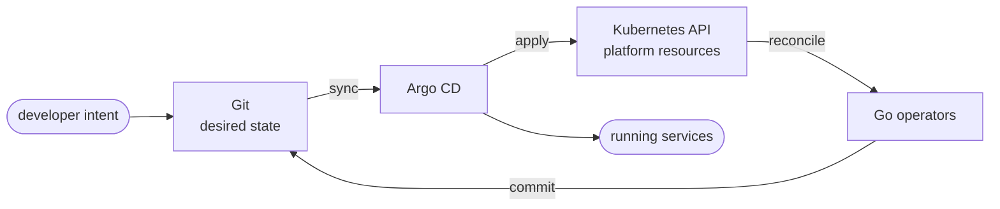

### 👋 This account holds the source code of [gerodimos.dev](https://gerodimos.dev)

A self-service **Internal Developer Platform** on Kubernetes, designed and built end to end by one engineer.
Developers onboard services, provision databases and ship deployments from a form in Backstage.
Go operators and GitOps do everything after that.

**[▶️ Watch the demos](https://gerodimos.dev/#demo)** · **[🧭 Explore the architecture](https://gerodimos.dev/#architecture)** · **[🌐 Live portal](https://platform.gerodimos.dev)** (only up while I'm working on it)

#### What's in here

- **4 Go operators** built with Kubebuilder, behind a platform API of four resources: `Component`, `Release`, `Database` and `DatabaseSchema`
- **Backstage golden paths** that each end in a reviewed pull request, plus portal views of rollouts, metrics and schemas
- **Hub-and-spoke GitOps:** one Argo CD on a management cluster delivers to dev and prod, all on AWS EKS
- **Crossplane APIs** for GitHub repositories and Postgres, released as versioned OCI packages

#### Where to start

| Area | Repositories |
|---|---|
| Platform control plane | [component-operator](https://github.com/entr0pian/component-operator) · [release-operator](https://github.com/entr0pian/release-operator) · [schema-operator](https://github.com/entr0pian/schema-operator) · [scaffold-operator](https://github.com/entr0pian/scaffold-operator) |
| Developer experience | [backstage](https://github.com/entr0pian/backstage) · [platform-scaffolds](https://github.com/entr0pian/platform-scaffolds) |
| GitOps & infrastructure | [application-repositories](https://github.com/entr0pian/application-repositories) · [argocd](https://github.com/entr0pian/argocd) · [crossplane-compositions](https://github.com/entr0pian/crossplane-compositions) · [helm-charts](https://github.com/entr0pian/helm-charts) |

Each repository's README explains its part of the platform.
For the design choices, trade-offs and what isn't built yet, see the [architecture pages](https://gerodimos.dev/#architecture).

📫 Want to talk about the platform? Find my contact details on [gerodimos.dev](https://gerodimos.dev/#about).
